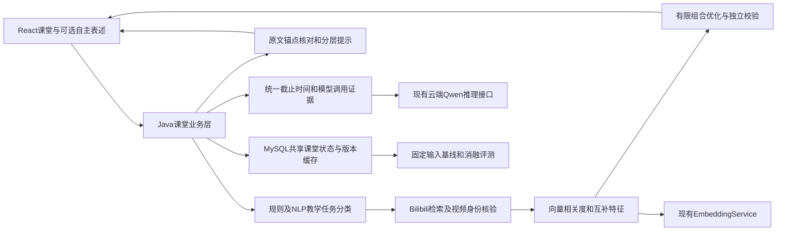
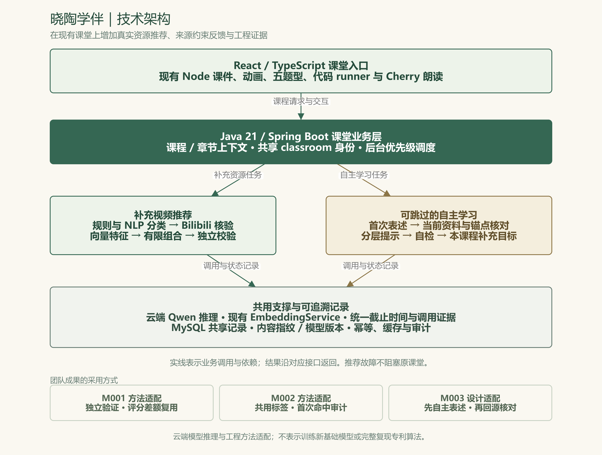
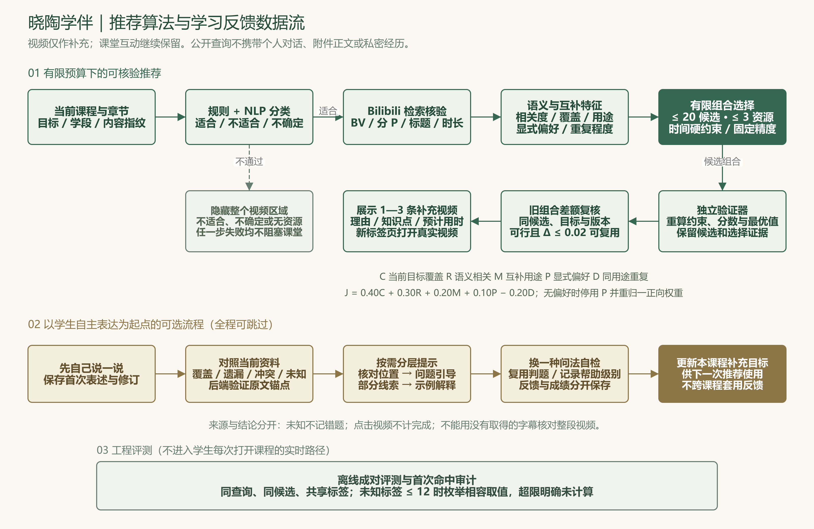

# 晓陶学伴：技术架构与创新

本轮主线是“教学任务识别→外部资源核验→约束组合选择→学生先表述→资料核对→工程评测”。面向乡村学生的适用性通过有限学习时间、可跳过步骤、现有互动课堂和故障不阻塞学习来实现；不会把乡村身份作为能力低的代理变量。

本轮新增内容与既有功能分开记载。四类成长课堂、代码runner、五题型、语音、知识库、`EvidenceSelector`和历史反思卡是已有基础；补充视频推荐、主组合算法、独立验证、差额复用、离散首次命中审计及来源约束反馈是本轮深化。

## 1. 技术架构

[可编辑架构图 SVG](research-20261016/figures/architecture.svg) · [FigureSpec 源文件](research-20261016/figures/specs/architecture.json)

[可编辑数据流图 SVG](research-20261016/figures/recommendation-flow.svg) · [FigureSpec 源文件](research-20261016/figures/specs/recommendation-flow.json) · [渲染与核验说明](research-20261016/figures/README.md)

推荐是低优先级后台任务，页面仅在ready且有合格资源时显示1—3条真实视频。外部资源不直接进入可执行课件，不接管原动画、练习或代码执行。课堂生成、补充推荐和代码runner继续保持独立职责。

## 2. AI技术与支撑技术的选型依据

| 任务 | 实际技术 | 选择理由与对比方案 | 代码证据与验证指标 | 失败行为 |
|---|---|---|---|---|
| 教学用途、目标和资料语义判断 | 已配置的Qwen云端模型，通过结构化HTTP调用 | 复用当前中文NLP能力；规则保证明确禁用情境，模型处理语义，不另训少样本分类器 | `VideoTeachingClassifier`、`ClassroomAiGateway`、`LearningFeedbackService`；记录合约通过率、引用支持、耗时和实际用量 | unknown与ineligible分开；不显示不可靠视频、不写未知错题 |
| 课程与资源匹配 | `EmbeddingService`实际配置的向量模型 | 词面匹配难覆盖同义表达；与词面/原搜索顺序基线对比；保留可替换提供方 | `ResourceSemanticFeatures`；provider/model/dimension/normalization绑定，余弦规范化 | 无效向量、零向量或中途模型变化使本次特征失效 |
| 选择资源组合 | 确定性有限枚举与独立十进制重算 | 最多1350组合，直接检验最优；不需部署随机群体优化或新增GPU | `RecommendationOptimizer`、`RecommendationVerifier`；目标、约束、输入置换、时间与基线 | 无可行组合返回空；输入错误不伪装正常结果 |
| 接口、取消与数据事务 | Java 21、Spring Boot、JDK HttpClient及现有MyBatis事务 | 与现有课堂后端一致；虚拟线程用于有界IO；原LangChain4j模块继续服务既有模型适配 | `ClassroomStudyContext/Store`、Gateway；幂等、取消、事务回滚与响应投影测试 | 独立失败，不破坏课件、成绩及已有记录 |
| 知识库检索与模型应用整合 | 现有LangChain4j、知识库和EvidenceSelector | 复用现有API与资料检索基础；新视频候选不混入文档片段选择器 | `pom.xml`及既有research模块；保留历史职责 | 推荐故障不要求重建原知识库 |
| 课件和前端 | Node课程引擎、React/TypeScript | 复用互动、播放器和暖色书院风；不另起展示站 | `CoursePlayer`、`SupplementaryVideos`、`StudyReflectionCard`；键盘、手机、外跳进度测试 | 所有非ready视频状态隐藏，学习可继续 |
| 跨设备共享、版本与审计 | MySQL增量表和内容指纹缓存 | 现有共享classroom身份无需新登录；指纹绑定资料而不是播放revision | `ClassroomStudyStore`；新表、幂等键和版本失效测试 | 旧课程正常读取，故障不覆盖原记录 |

这里的AI技术是调用已训练的基础模型进行推理，并由应用代码约束、核验和组合输出。本轮没有PyTorch训练数据、训练脚本或新模型权重，因此不声明自研基础大模型或新增深度学习训练框架。运行时模型名称以响应证据为准，不能把配置默认值当成实际成功调用的模型。

## 3. 可以由代码说明的改进

1. **教学任务先于资源排序。** 同一门语文课中，诵读可补充真实示范，个人错题纠正优先留在课堂；这在分类规则及结构化输出验证中可定位。
2. **从单条相似度改为受时间约束的组合。** 只覆盖当前目标，以同用途重复惩罚和用途互补降低三条资源重复讲解同一点的风险。
3. **推荐更新可独立复核。** 新组合和旧组合使用同一候选/目标/版本，差额阈值仅用于评分模型内的稳定复用；独立校验器避免算法自证。
4. **学生贡献和AI反馈有可追溯边界。** 首次表述、帮助级别、原文锚点、自检提交分开保存，用户可以跳过；引用必须属于当前资料且真实存在。
5. **比较算法时保留共用信息。** 首次命中审计使两种排序对同一资源共享标签，未知不当失败；固定输入实验单列搜索、模型、优化和总成本。

以上是工程方法适配和产品设计改进。团队论文与专利的完整算法、假设和试验场景各不相同；项目不会把原论文的数值提升、微电网损失界或连续几何证书搬成教育效果结论。

## 4. 与评分标准的对应关系

评分依据为用户提供的《全球校园人工智能算法精英大赛评分标准.mhtml》及其中“技术架构与创新”要求。对应官方页面：[评分规则](https://www.aicomp.cn/tracks/tracks-2/3792.html)。评分表用于组织可检查材料，不构成获得相应分数的承诺。

| 评分项 | 权重 | 本轮应交付的可检查证据 |
|---|---:|---|
| 创新性 | 20 | 原文段落—业务改造—代码—验证四联；明确借鉴与新增，不堆砌框架名 |
| 技术实现 | 20 | 实际模型响应、资源核验、组合最优验证、有界请求、幂等和回滚 |
| 功能完整性 | 20 | 分类、真实推荐、外跳、可跳过自主表述、资料核对、提示、自检全流程 |
| 方案完整性 | 20 | 架构、接口、持久化、缓存、失败行为、兼容迁移和恢复方案 |
| 应用价值 | 15 | 有限时间内的补充资源、易理解理由、手机操作、故障不中断学习；教学效益保留后续验证 |
| 总结与展望 | 5 | 真实测试结果、失败分母、来源范围、工程指标与教学效果的边界 |

## 5. 验证状态与复核入口

核心24项测试的既有通过日志位于 `target/recommendation-core-check/test-results.log`。新增API、前端和全链路评测由主任务完成后更新本轮证据总览；测试函数存在、文件成功生成和在线调用成功分别记录，不能互相替代。

固定评测分为72条分类夹具、30组真实查询快照及40组资料核对案例；算法使用相同候选与特征比较基线和消融。未经过教师复核的标签明确为工程/代理标签，不汇报为教师评审准确率或学生学习提升。

技术清单：[机器可读选型依据](research-20261016/技术选型清单.json)。原文定位、代码锚点和实际结果：[便携证据清单](research-20261016/README.md)。完整原件、实际原页和逐段截图保存在项目本地 `团队成果参考库/本轮算法深化_20261016`。参考项目适配差异：[迁移清单](参考项目迁移清单_20261016.md)。
