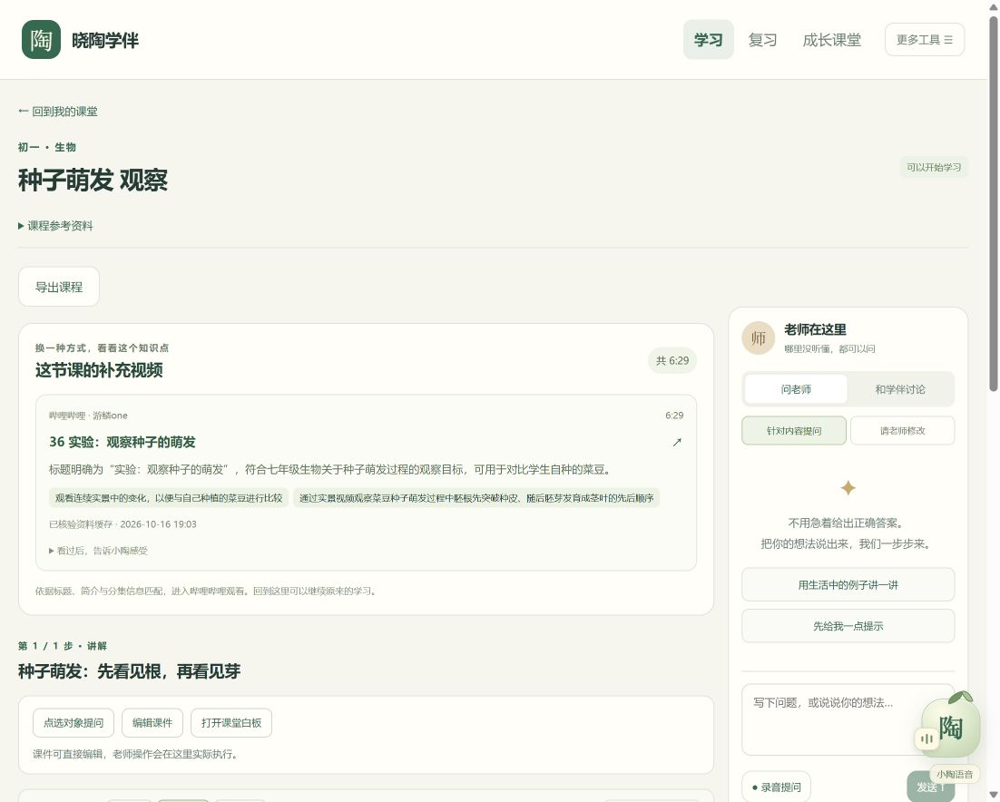
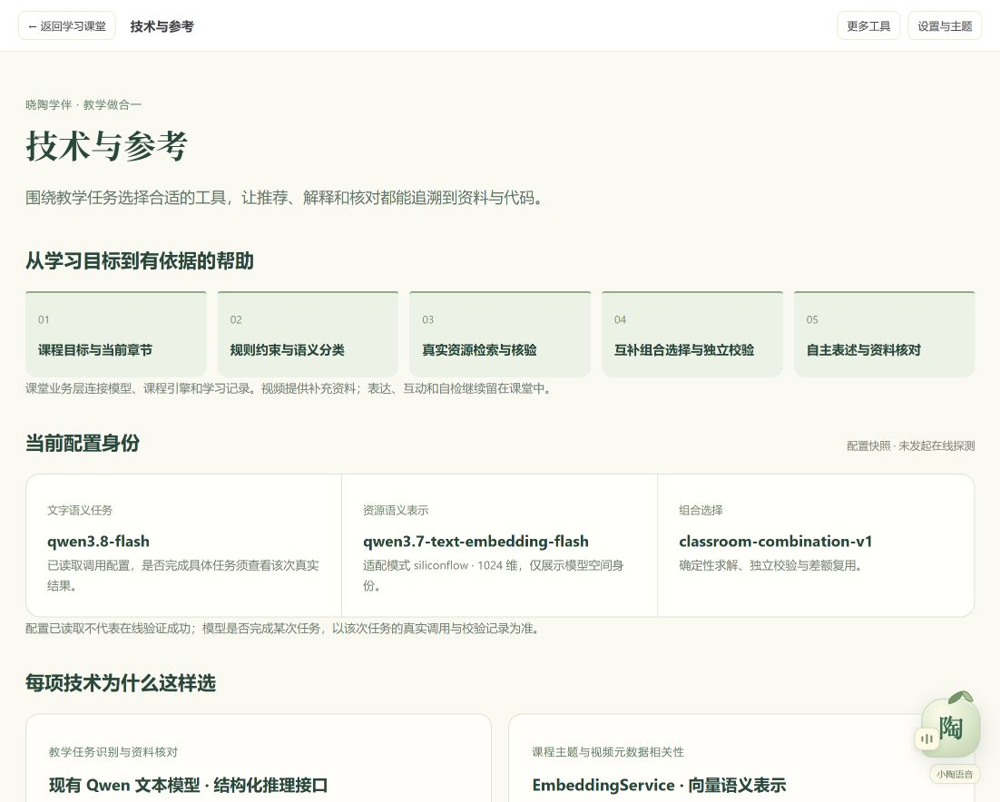
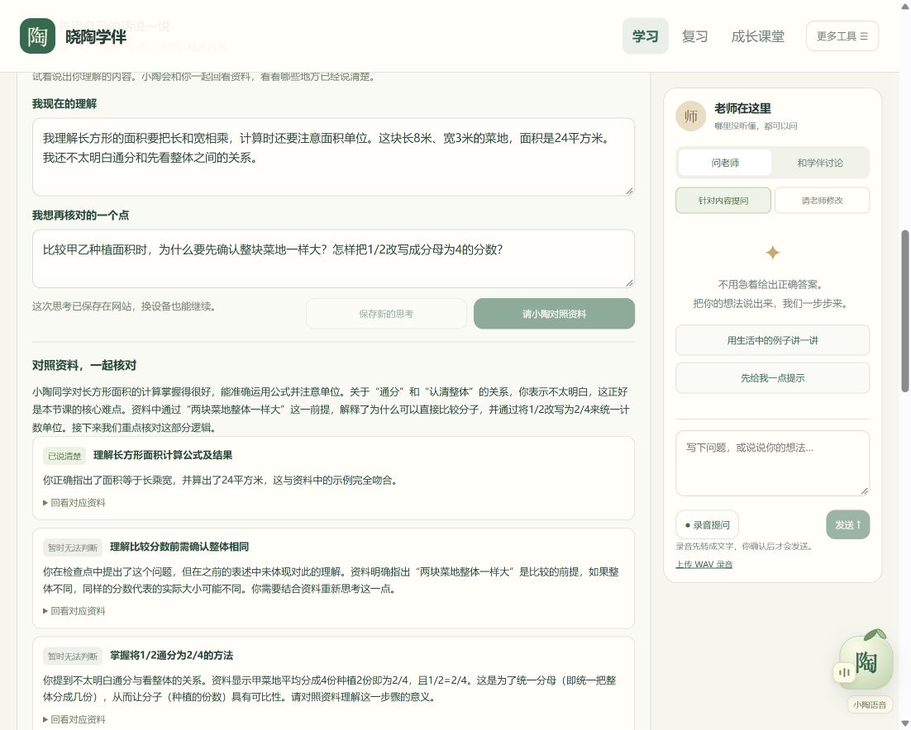

# 晓陶学伴：补充视频、学习核对与算法证据测试报告

日期：2026年10月16日。最终版本为20261016-xiaotao-15，功能与布局验收完成。后端全量环境错误、模型初测失败、无结果及未确定案例继续保留；本报告不把工程代理指标解释为教学效果。

## 1. 验收状态总表

|验证项目|已完成结果|当前结论|
|---|---|---|
|前端测试|最终19个测试文件、179项通过|PASS；不与此前178项重复相加|
|前端类型检查、发布构建|最终检查和公网构建通过；公网标志及静态mtime已修复|PASS；最终v15静态部署与布局回查通过|
|课程引擎|27项测试、构建通过|PASS|
|后端全量快照|752项，0失败、14错误、1跳过|未通过：既有本机MySQL认证错误|
|后端修补后针对性检查|此前284项通过；v13批次296项全部通过|PASS；按批次记录，不重复累计|
|编程概念门控补充检查|7项通过|PASS；与上一批可能重叠，不相加为唯一测试数|
|后端打包|v13首次受百度云临时cfg竞态打断；排除该临时文件后重试通过|PASS；首次失败日志保留|
|教学任务分类|初测冻结版72条均符合工程预期；48次模型调用、24条规则处理|工程符合性通过，未人工审核|
|资料核对初测r1|40条均返回，35条符合预期、5条歧义处理不符|保留初测不足|
|资料核对修复回归r2|40条中38条确认且符合预期，2条契约失败未确定|PARTIAL；开发期回归|
|公开资源快照|30查询成功，240次候选出现、238独立BV|身份及元数据核验通过，未审阅完整视频|
|固定推荐业务结果|23可展示、6隐藏、1错误|完整30条分母保留|
|有限模型算法比较|24组可比较，含1组有效空可行集|24组独立最优验证通过|
|服务器优化器性能|真实24输入P95 0.832518ms；20候选容量夹具P95 8.018594ms|均满足100ms目标，排除模型/网络耗时|
|正式网站四语言及取消|4语言真实执行、8次跨身份404、1次取消和3次稳定回读|PASS|
|正式网站学习核对|首次表述、核对、4层提示、新版本及历史保留通过；自检后续根据公开题意提交正确|分两份回执保留，见第4节|
|正式网站补充视频|首轮2/4符合预期；v13新回执3正例+1排除情境全部通过|PASS；首轮失败保留|
|真实新课教学检查|两轮失败保留；v13有原因引导的再生成得到4页passed|PASS_CONTENT_ONLY；未宣称互动运行验证|
|原记录和朗读回查|4成长组各2条共享消息、16道错题；Cherry新合成22,797字节|PASS；为该回查时点快照|
|课程导出|HTML实际下载、PPTX ZIP与备注来源检查通过|PASS_STRUCTURE；未作Office视觉验收|
|最终发布|v15静态发布完成；后端与v13相同；六服务active|PASS；最终源码已推送并读回|

全量后端错误的日志根因是现有本机MySQL对`root@localhost`的认证失败；不能将这次构建写成全通过。新增及受影响模块的针对性测试和全量环境失败分开报告。

## 2. 分类、反馈与原始失败

72条分类夹具跨小学、初中、高中，预期分为适合、不适合和不确定。标签由开发过程依据已批准契约编写，未经过教师人工审核；72/72表示本组工程预期一致，不能外推为实际课程分类准确率。门控反事实比较没有执行任何搜索：无门控策略允许72条，实际分类仅允许24条，24条明确排除与24条不确定均不外搜。

40条资料核对包含同义表达8条、遗漏8条、冲突8条、无证据6条、资料歧义5条和版本变化5条。r1的5条歧义结果不符契约，触发通用来源一致性修复；原始输出与标签均未覆盖。r2是看过r1后的开发回归，不是独立留出验证。

r2的`FB-paraphrase-02`和`FB-conflict-07`各经历最多两次结构尝试后仍为`contract-invalid`。完整分母是40，其中38条确认、2条未确定；不能写成40/40通过，也不能把2条未知当成学生答错。

所有首次表述、AI核对、自检成绩与外部视频点击分别记录。调用失败或证据不足不会形成错误成绩，不凭一次表述、观看行为或乡村身份判断学习能力。

## 3. 真实资源与主算法结果

30条公开查询共得到240次候选出现、238个独立BV，公开详情核验完成。固定快照后的特征提取使用真实文本与向量模型，没有再次检索；生产优化器、独立校验器和首次命中审计使用相同固定输入。

|完整分母|数量|处理方式|
|---|---:|---|
|可展示的有效推荐|23|进入正常视频卡片|
|预算导致有效空可行集|1|候选全部超过600秒；纳入算法比较，业务隐藏|
|语义/学段匹配未得到候选|2|隐藏；保留过度保守可能性|
|分类器判不适用|3|隐藏；保留编程概念被过度阻断问题|
|模型输出契约失败|1|错误保持未确定，不当作资源不相关|
|合计|30|其中24组可比较、6组不可比较但保留|

独立验证确认24/24组最优解与约束成立。其中穷举和贪心24/24选择一致，不能宣传本批已经证明穷举胜过贪心。移除语义相关度导致11/24组选择变化；移除覆盖或重复惩罚均为0变化；控制反馈重点的成对输入也为0变化。这批多为单目标输入，尚未揭示复杂覆盖、互补组合或反馈目标的增量收益。

联合首次命中分别比较“检索顺序—语义排序”和“检索顺序—最优选中ID优先的完整排序”。同一资源共享标签，未知标签不转成负例。两类比较的24组区间都包含0，因此现有证据不能严格证明任何一类顺序节省查看次数。

完整均值、每条查询、消融及区间见[工程评测结果](research-20261016/工程评测结果.md)和[机器可读摘要](research-20261016/工程评测结果.json)。这些分数是既定有限目标函数指标，不是独立教学质量或学生成绩提升。

## 4. 正式网站实际流程及修复回归

### 4.1 学习核对与自检

正式网站真实保存了首次理解、调用小陶核对、依次显示4层提示，并保存关联的新表述版本。历史中的首次正文保留；课件正文、播放位置及既有错题在该次流程前后保持一致。

第一份自动验证回执为`live-feedback-smoke.json`，状态仍为`PARTIAL`：脚本无法依据其严格解题白名单确定自检答案，于是没有猜测提交，也没有制造错误成绩。这表示自动测试的解题覆盖不足，不表示核对和提示接口失败。

第二份回执`live-feedback-manual-answer.json`记录根任务随后根据公开题干、选项和课件知识分析选择A，实际提交返回`correct=true`，未使用隐藏标准答案。两份回执必须同时保留：第一份的自动测试中止事实不能被第二份成功覆盖。这里的“根据题意作答”是验收代理的后续操作，不冒充教师人工评审。

### 4.2 视频推荐首轮

|正式站情境|首轮结果|已知问题或依据|
|---|---|---|
|《沁园春·长沙》诵读补充|未通过，契约失败|原失败保留；v13补充诊断与查询边界修复待重新核对|
|英语th发音示范|隐藏，正例未通过|公开查询携带较长课标题描述，返回候选适配不足；查询简化待v13验证|
|种子萌发观察|可展示|实际模型匹配与元数据缓存边界生效|
|身心成长排除情境|隐藏|审计确认没有执行外部搜索|

首轮4个情境中，2个符合预期、2个未通过；只看3个应推荐正例时为1/3，不以排除情境通过掩盖正例不足。冻结资源评测中的水循环/折射学段筛选，以及Python循环、Java递归概念被当作调试的过度阻断问题也保留在评测结果中；通用边界修订不能反写初测结果。

v13查询和结构诊断修复后的新回执为`live-video-smoke-v13/report.json`：沁园春诵读、th发音、种子萌发3个正例均返回1条可展示的真实资源；身心成长排除情境保持隐藏且未外搜，合计4/4符合预期。此回归证明这些现场流程已恢复，不改变原30条固定输入的23可展示、6隐藏、1错误统计，也不等于服务器详情端点已恢复。

### 4.3 Bilibili详情访问限制

正式服务器公开详情端点出现HTTP412；没有绕过风控、自动换代理或下载视频。已核验元数据种子从238个独立BV中接受237个，另1个因分P标题为空被拒绝。重复记录合并，原始`verifiedAt`保留，导入不延长核验有效期。

缓存复用仍要求本次公开搜索成功，并且BV、标题及作者严格匹配。第一次详情412后停止该任务对此端点的继续请求，只能使用尚未超过24小时的合格旧核验记录；卡片沿用原核验时间，审计明确缓存及412来源。**缓存过期而详情仍不可用时隐藏推荐区域。** 因此当前实测不能等同于服务器详情访问已经恢复，也不能承诺所有新主题随时可推荐。

### 4.4 四语言与课程回归

JavaScript、Python、C++、Java各完成一次真实面积程序运行，行号、变量与轨迹均有返回。8次其他浏览器身份读取/删除检查返回404。1次长任务取消后保留43步轨迹，3次回读状态稳定，最终`tracePending=false`。

真实新课《光照与影子的方向》保留三个阶段：v12因非法修订patch停止；v13第一轮因内容超出来源范围停止；读取失败原因后进行有原因引导的再生成，最终ready且4页教学检查均为passed。三份原回执分别保留，没有把失败请求改写为成功。最终标记明确为`scope=content-only`、`runtimeVerified=false`，因此证明的是内容检查流程，不声称所有生成互动已执行验证。

正式站回查另确认四个成长大类各有2条共享消息、错题总数16，Cherry·芊悦新合成音频22,797字节。该记录是回查时点结果，先于最终新课生成的课程状态不能冒充新课终态。HTML导出已实际下载并验证补充链接及私有trace排除；PPTX已验证ZIP结构和备注中的补充来源，没有进行Microsoft Office最终视觉渲染，故不声明Office排版验收。

## 5. 性能实测

正式Linux服务器、Java21.0.12.1。真实输入场景在同24个冻结特征输入之间轮转，整体预热150次、采样500次；P50为0.104117ms，P95为0.832518ms，最大6.189991ms。20候选合成容量场景独立预热150次、采样500次，P50为2.811906ms，P95为8.018594ms，最大40.915628ms。

两项P95均低于100ms目标。该指标只包含优化器，不含检索、模型调用、向量生成或独立Verifier。合成容量夹具只验证上限性能，不加入真实资源样本，不作为教学效果证据。本机Windows的0.1338ms P95独立保留，未用其代替服务器测量。

## 6. 最终发布与数据保全

最终线上版本为`20261016-xiaotao-15`，采用公网课堂构建。14、15版只修正长反馈布局与手机按钮间距，后端JAR与13版完全相同，六项服务PID均未改变。源码定位提交为`d28e4a9abf185e5467639b9f16397340a4e6a12c`，已推送至私有仓库并读回。最终证据文档的Git提交号见本地交付回执。

首次切换时原12门课程文档逐字节一致；最终回查12门原课程仍全部存在，播放位置与基线相同，16条原错题ID保持不变。当前15门课程包含本轮新增的两门视频演示微课与一门真实生成验收课程；独立自检产生一条正常正确作答，没有新增错题。网站引擎ready，生成任务为0，Cherry实际短句合成返回22,797字节音频。

桌面1102像素及手机390像素下，展开完整反馈、长历史表述和自检选项后，文档宽度均等于视口宽度；移动端按钮恢复正常内容高度。修复前两张问题图保存在本地验收目录，正式截图仅使用修复后结果。原练习页的视频区域计数为0，没有失败占位推荐。

|最终项目|结果|
|---|---|
|前端|19文件、179项测试通过；类型检查及公网构建通过|
|后端受影响范围|296项通过，打包通过；全量752项中的14个既有MySQL环境错误仍列为未通过|
|推荐代表流程|沁园春诵读、th发音、种子观察3正例通过；私密话题规则排除且没有搜索调用|
|学习闭环|首次表述、来源核对、4层提示、后续版本及正确自检通过，操作回执分别保留|
|新增课件检查|四页真实生成后均通过内容核对；前两轮被拒草稿与原因保留|
|四语言与取消|最终v15再次实测通过；JavaScript、Python、C++、Java均有真实输出与轨迹|
|导出|HTML实际下载并验证来源；PPTX ZIP结构和演讲者备注保留视频链接，未声称Office视觉验收|
|部署与恢复|6项服务active；原数据保全通过；集中备份及代码回退入口保留|

原文版本、20张原页、22处真实裁图和51处代码/测试锚点重新核验通过。部署期间同步程序的临时文件曾影响打包、验收回执写入和临时目录清理；JAR排除该临时文件后打包成功。最终四语言实测结果完整保留，取消流程另以只写一次的独立回执补测通过，原文件锁失败日志保留。清理被占用及自动审批拦截的临时源码目录仍保留，不影响已验证的发布源码和网站运行。

## 7. 证据与复核

可发布证据包括[来源与实现索引](research-20261016/README.md)、[验证状态](research-20261016/验证状态.json)、[工程评测结果](research-20261016/工程评测结果.md)及[评测脚本说明](../scripts/research-evaluation/README.md)。

[可移植冻结输入](research-20261016/frozen-optimizer-inputs/README.md)已实际离线重放24/24一致，覆盖五种基线、最优选择、独立验证、全部数值消融与两类首次命中审计。该子集含一个有效空集；其余6条不可比较结果仍保留在完整30条分母中。重放未调用模型、搜索或数据库。

本地原始回执按运行阶段保留，包括`backend-full-final.log`、`backend-postpatch.log`、`backend-v13.log`、两份v13打包日志、`frontend-*-release.log`、`optimizer-server-timing.json`、两份v12/v13切换日志、`public-code-api-report.json`、两份反馈操作回执、两轮视频验收、三轮新课教学检查、`live-existing-readback.json`及`live-export-verification.json`。原始提示、模型回答、请求ID及内部配置不随可发布报告复制。

## 8. 正式页面截图

[手机视频页](research-20261016/screenshots/videos-mobile.jpg) · [手机反馈页](research-20261016/screenshots/feedback-mobile.jpg)。
